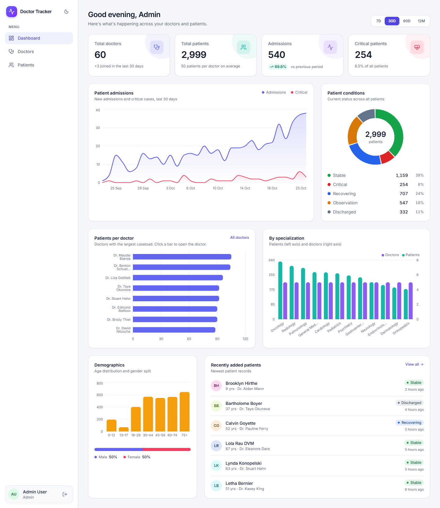
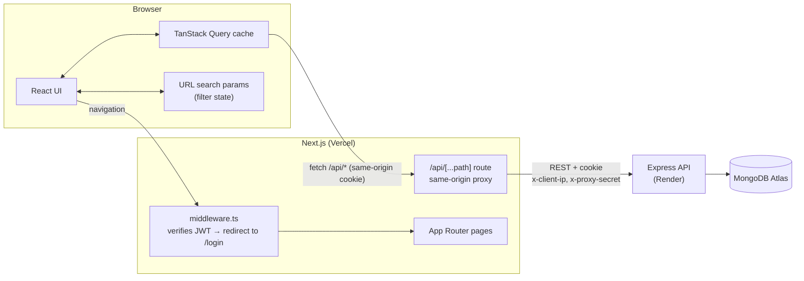
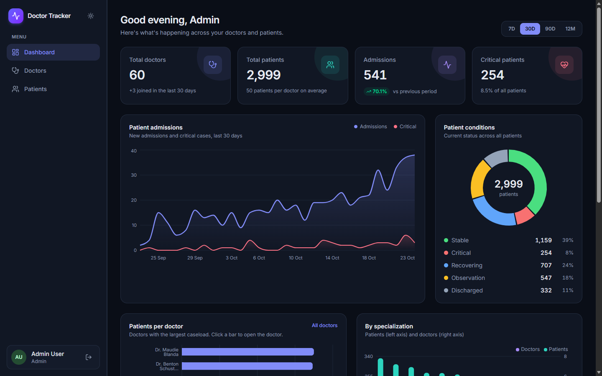
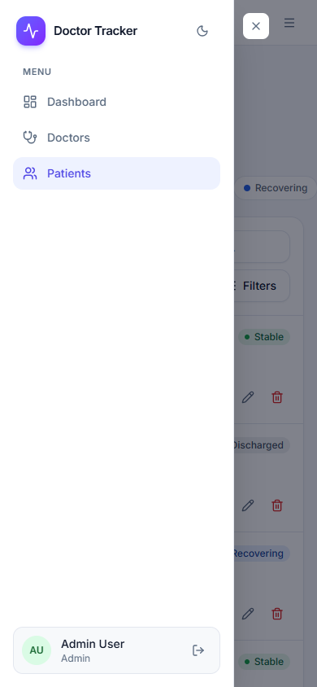

# Doctor Tracker: Frontend

> Next.js admin portal for managing doctors, their patients and clinical analytics. Fast, responsive and accessible.

## Description

**Doctor Tracker** gives hospital administrators one place to run their doctor roster and patient caseload. Signed-in staff can:

- register doctors, and open any doctor to manage their patients;
- work through thousands of patient records with instant search, date and condition filters, and pagination;
- read an analytics dashboard: admission trends, critical-case volume, patients per doctor, specialization load and demographics.

This repository is the **Next.js 15 frontend**. It talks to the **[Express + MongoDB REST API](https://github.com/saiful199324/doctor-tracker-backend)** through a same-origin server-side proxy. It's responsive from 320 px phones to wide desktops, supports dark mode, and passes WCAG 2 AA accessibility checks.



## Links

| | |
| --- | --- |
| **Live website** | **https://doctor-tracker-frontend-two.vercel.app** |
| **Live backend API** | https://doctor-tracker-api-4x90.onrender.com |
| **Backend repository** | https://github.com/saiful199324/doctor-tracker-backend |
| **Admin** (full access) | `admin@doctortracker.dev` / `Admin@12345` |
| **Staff** (no deletes) | `staff@doctortracker.dev` / `Staff@12345` |

> The login page has a **Fill demo credentials** button. The API runs on Render's free plan; if it has been idle, the first sign-in can take up to a minute while it wakes up.

## Quick start

### Try the live app

Open **https://doctor-tracker-frontend-two.vercel.app**, click **Fill demo credentials**, then **Sign in**. If the API has been idle (outside 08:00–23:00 Bangladesh time), the first sign-in can take up to a minute while it wakes up.

### Run the whole app locally

The app has two parts, and you run both. You need **[Node.js 20+](https://nodejs.org)** and **[Docker Desktop](https://www.docker.com/products/docker-desktop/)** for MongoDB, or a free [MongoDB Atlas](https://www.mongodb.com/atlas) connection string in `MONGODB_URI`.

**Terminal 1: backend API** → http://localhost:4000

```bash
git clone https://github.com/saiful199324/doctor-tracker-backend.git
cd doctor-tracker-backend
npm install
cp .env.example .env          # defaults work as-is
docker compose up -d          # MongoDB on 127.0.0.1:27017
npm run seed                  # demo users, 60 doctors, 3,000 patients + indexes
npm run dev
```

**Terminal 2: frontend website** → http://localhost:3000

```bash
git clone https://github.com/saiful199324/doctor-tracker-frontend.git
cd doctor-tracker-frontend
npm install
cp .env.example .env.local    # already points to http://localhost:4000
npm run dev
```

Open **http://localhost:3000** and sign in with `admin@doctortracker.dev` / `Admin@12345`.

| Problem | Fix |
| --- | --- |
| "Invalid environment configuration" (API) | Run `cp .env.example .env`; the message names the missing variable |
| "Invalid email or password" | Run `npm run seed` in the backend |
| Signing in sends you back to the login page | `JWT_SECRET` must be identical in the backend `.env` and the frontend `.env.local` (the examples already match) |
| "The API is unreachable" | Start the backend, and keep the frontend's `API_URL=http://localhost:4000` |
| ECONNREFUSED 127.0.0.1:27017 | Start Docker Desktop, then `docker compose up -d` |
| Port 3000 / 4000 in use | Change the backend's `PORT` (and the frontend's `API_URL` to match), or `npx next dev -p 3001` |
| `cp` not recognised (Windows `cmd`) | Use `copy .env.example .env`, or PowerShell or Git Bash |

---

## Table of contents

0. [Quick start](#quick-start)
1. [Features](#features)
2. [Tech stack](#tech-stack)
3. [Setup guide](#setup-guide)
4. [System architecture](#system-architecture)
5. [Technical decisions](#technical-decisions)
6. [Performance](#performance)
7. [Project structure](#project-structure)
8. [Deployment](#deployment)
9. [Visual evidence](#visual-evidence)

## Features

| Area | What you can do |
| --- | --- |
| **Authentication** | Sign in and out. Every page is protected by middleware that **cryptographically verifies** the session before rendering. Delete buttons are hidden for the `staff` role. |
| **Dashboard** | KPI cards with period-over-period trend, an admissions timeline (7D / 30D / 90D / 12M), a condition donut, a patients-per-doctor ranking (click to open a doctor), patients and doctors by specialization, age and gender demographics, and recently added patients. |
| **Doctors** | Create, edit and delete doctors. Search, filter by specialization / hospital / join date, sort and paginate. Each row shows a live patient count. |
| **Doctor detail** | Profile, caseload by condition, and the doctor's own searchable, filterable, paginated patient list. Add patients under the doctor and remove them. |
| **Patients** | Every patient in one list: add, edit and delete. Search by name, phone, email or diagnosis. Filter by condition, doctor, gender, age group and admission date. |
| **UX** | URL-synced filters (shareable, back/forward), skeleton loaders, empty and error states, toasts, confirmation dialogs, dark mode, a branded 404 page, a skip link, visible focus, "reduce motion" support, and tables that become cards below 1280 px. |

## Tech stack

| Concern | Choice |
| --- | --- |
| Framework | Next.js 15 (App Router), React 19, TypeScript |
| Styling | Tailwind CSS v4 with CSS-variable design tokens (light + dark) |
| Server state | TanStack Query v5 |
| Forms | React Hook Form + Zod (the same rules as the API) |
| Charts | Recharts 3 |
| Auth check | `jose` (HS256 JWT verification in middleware) |

---

## Setup guide

### Prerequisites

- **Node.js 20+** and npm
- The **[backend API](https://github.com/saiful199324/doctor-tracker-backend)** running locally (default `http://localhost:4000`) or deployed

### 1. Clone and install

```bash
git clone https://github.com/saiful199324/doctor-tracker-frontend.git
cd doctor-tracker-frontend
npm install
```

### 2. Configure environment

```bash
cp .env.example .env.local
```

| Variable | Purpose |
| --- | --- |
| `API_URL` | Base URL of the backend API that the `/api/*` proxy forwards to (default `http://localhost:4000`) |
| `JWT_SECRET` | **Same value as the backend's `JWT_SECRET`**; the middleware verifies session signatures with it |
| `PROXY_SECRET` | Optional, **same value as the backend's**; lets the proxy forward visitors' real IPs to the API's rate limiter |

The example values match the backend's `.env.example`, so local development works without edits.

### 3. Run

```bash
npm run dev                 # http://localhost:3000
npm run build && npm start  # production build
npm run lint && npm run typecheck
```

Open **http://localhost:3000** and sign in with a demo account. The backend's `npm run seed` creates them.

---

## System architecture



**Data flow**

1. **Navigation.** `src/middleware.ts` verifies the `dt_token` JWT (HS256 signature, pinned algorithm, expiry) with `jose` before any protected page renders. A missing, forged or expired token redirects to `/login?next=…` and deletes the bad cookie. It fails closed: with no secret configured, everyone counts as signed out.
2. **Data.** Client components call typed hooks (`useDoctors`, `usePatients`, `useOverview`, …). TanStack Query caches responses, de-duplicates requests, cancels stale ones (`AbortSignal`) and keeps the previous page visible while the next loads.
3. **Proxy.** The browser only calls this site's own `/api/*`. `src/app/api/[...path]/route.ts` forwards each request to `API_URL` and returns the response unchanged, including `Set-Cookie`. The session cookie therefore stays **first-party** and no CORS is needed. The proxy also passes the visitor's IP with a shared secret.
4. **Writes.** Mutations invalidate the matching query keys (doctors, patients, stats), so every open view refreshes.

---

## Technical decisions

### 1. TanStack Query for server state + the URL for filter state, instead of Redux or Context

**Problem.** Almost all of this app's state is *server* state: paginated lists, counts and aggregates that live in MongoDB. The rest is *filter* state (search, page, sort, dates) that users expect to survive a refresh and work with the back button.

**Why not Redux or Context?** Redux would mean hand-writing loading flags, caching, invalidation, de-duplication and cancellation. A Context holding filters or data re-renders *every* consumer on *any* change, and still doesn't cache.

**What we do instead:**
- **TanStack Query owns server state.** Hierarchical keys (`['doctors', 'list', params]`, `['doctors', 'detail', id, 'patients', params]`) let one `invalidateQueries(['doctors'])` refresh every affected view. `keepPreviousData` keeps the current page visible while the next loads. Retries are skipped for 4xx errors.
- **The URL owns filter state** (`useUrlFilters`). `?search=card&specialization=Cardiology&page=2` is the single source of truth: shareable, bookmarkable, and restored on refresh and back/forward.
- **Local `useState`** handles the rest (open dialogs, the row being edited).

**Measured re-renders** (with a React commit hook):

| Action | What re-renders |
| --- | --- |
| Typing 5 characters in search | only the search box; table **0×** until the 350 ms debounce, then once |
| Opening and closing the edit dialog | table and rows **0×** |
| Typing in a form | form once (dirty flag), not per keystroke (uncontrolled inputs) |
| Dashboard range switch | each chart and KPI card **once** |

### 2. A same-origin server-side proxy, instead of calling the API cross-origin

**Problem.** The frontend (Vercel) and the API (Render) live on different domains. If the browser called the API directly, the session cookie would be a **third-party cookie**, which Safari and private browsing block. Making it work would also mean `SameSite=None`, which reopens CSRF exposure.

**Decision.** The browser only calls this site's own `/api/*`, and a catch-all route handler forwards each request to the API on the server:
- The `httpOnly` session cookie is **first-party** on the website's domain, works in every browser, and stays `SameSite=Lax`.
- **No CORS** preflights, and JavaScript never touches the token.
- Middleware can verify the same cookie before rendering a page, so protected pages never flash.
- The proxy forwards the **visitor's real IP** (`x-client-ip`) with a shared `x-proxy-secret`. The API trusts it only when the secret matches, so its login rate limiter counts real visitors, and a client calling the API directly can't fake an IP. Any `x-client-ip` or `x-proxy-secret` headers a visitor sends are stripped.
- A route handler (rather than a `next.config` rewrite) behaves the same on any host and returns a clean 502 JSON if the API is unreachable.

**Trade-off.** Each API call has one extra server hop. The Vercel function region is pinned to Singapore (`vercel.json`), next to the API, to keep that hop short.

---

## Performance

- Route-level code splitting: Recharts only loads on the dashboard (≈ 266 kB first load vs ≈ 180 kB elsewhere), plus `optimizePackageImports` for `lucide-react`, `recharts` and `date-fns`.
- Debounced search, cancelled in-flight requests, `keepPreviousData` paging, and `memo`/`useCallback`/`useMemo` on hot paths (measured above).
- Skeletons sized like the real content (no layout shift). The theme is applied by an inline script before first paint (no flash).
- Charts respect `prefers-reduced-motion`.

## Project structure

```
src/
├── middleware.ts          # route guard: verifies the session JWT before rendering
├── app/
│   ├── api/[...path]/     # same-origin proxy to the backend API
│   ├── login/
│   ├── not-found.tsx      # branded 404
│   └── (app)/             # authenticated layout (AppShell) + error.tsx boundary
│       ├── dashboard/  ├── doctors/[id]/  └── patients/
├── components/
│   ├── ui/                # Button, Field/Input/Select, Modal, ConfirmDialog, Pagination, Card…
│   ├── layout/            # AppShell, PageHeader, ThemeToggle
│   ├── shared/            # SearchInput, FilterPanel, ConditionBadge
│   ├── dashboard/         # StatCard, charts
│   ├── doctors/           # DoctorFormModal
│   └── patients/          # PatientFormModal, PatientTable
├── hooks/                 # use-auth, use-doctors, use-patients, use-stats, use-url-filters, use-debounce, use-reduced-motion
└── lib/                   # api client, types, query keys, utils
```

## Deployment

Deployed on **Vercel** (Hobby plan). The function region is pinned to `sin1` (Singapore) in [`vercel.json`](vercel.json), next to the API on Render.

- **Environment variables:** `API_URL` (the Render API URL), `JWT_SECRET` and `PROXY_SECRET` (both identical to the backend's).
- The backend allows this site's origin through its `CLIENT_ORIGIN` setting.

## Visual evidence

### Desktop

| Dashboard (light) | Dashboard (dark) |
| --- | --- |
|  |  |

| Doctors (search + filters) | Doctor detail & patients |
| --- | --- |
|  |  |

| Patients | Add patient |
| --- | --- |
|  |  |


### Mobile

| Login | Dashboard | Doctors | Patients | Navigation |
| --- | --- | --- | --- | --- |
|  |  |  |  |  |
